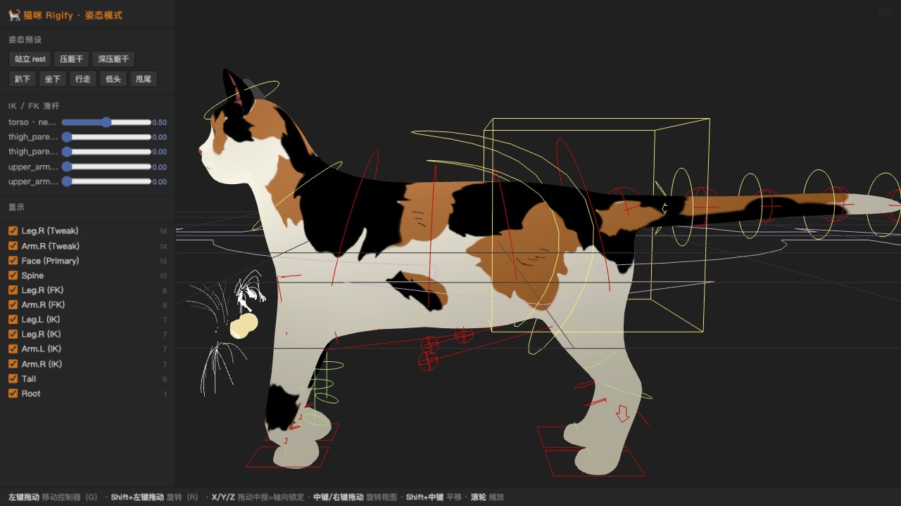
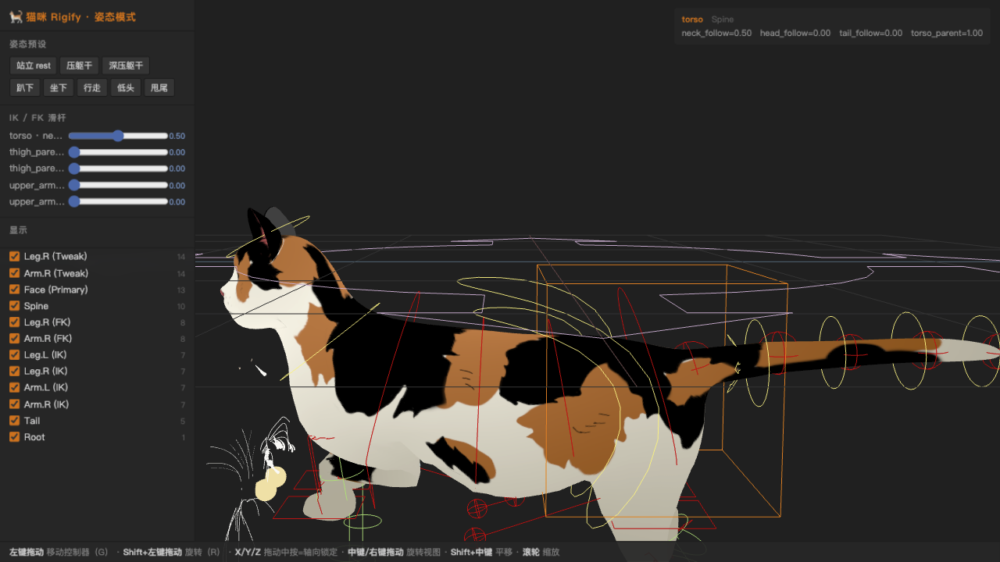
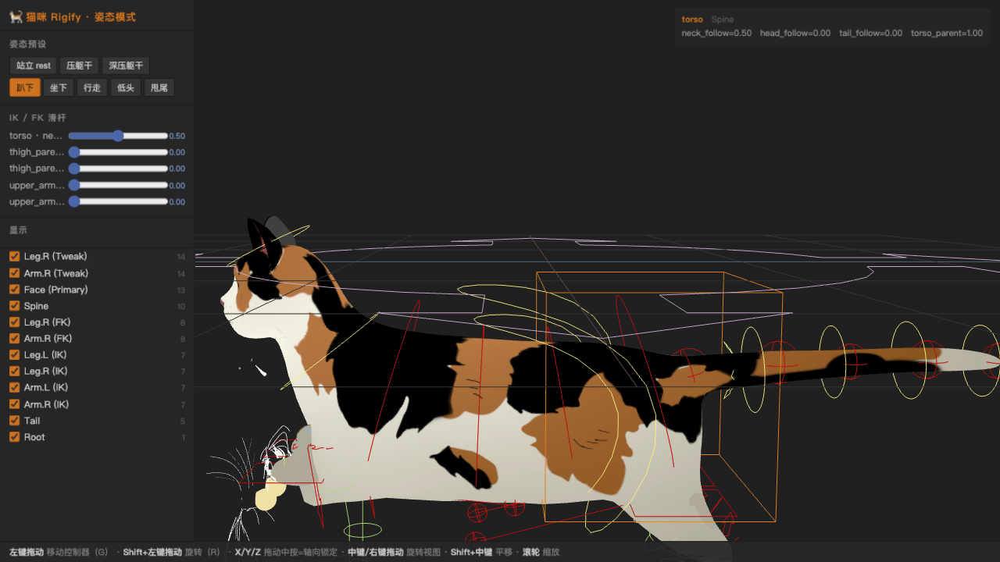
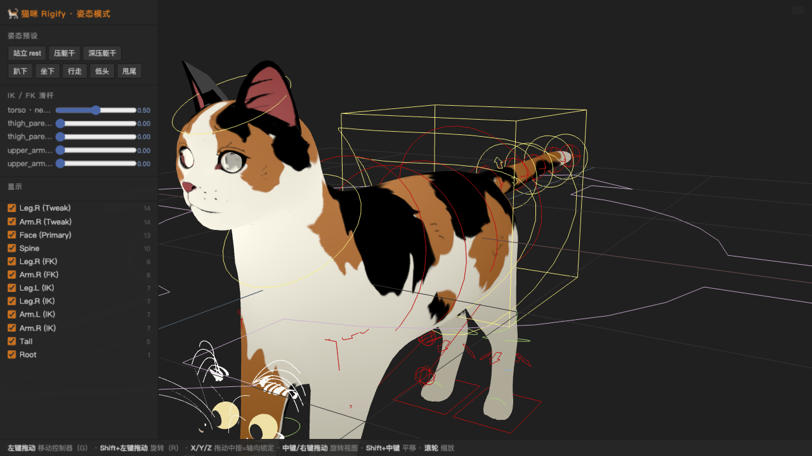

# 宠影孪生-数字孪生体操作平台

把 **Blender Rigify 绑定的猫咪**（328 骨、97 个控制器 widget）搬进浏览器：
像 Blender 姿态模式一样**拖拽 widget 控制器**，蒙皮模型实时反馈，IK / 约束 / 驱动器行为与 Blender 对齐。

| 站立（rest） | 拖拽 torso 下压 → 屈肢蹲伏 |
|---|---|
|  |  |
| **趴下预设**（Blender 真值姿态） | 前侧 3/4 视图 |
|  |  |

> 核心验收：**鼠标按住 torso 控制器向下拖** —— 身体下压、前后肢折叠、脚掌钉在地面，
> 膝/肘极向与 Blender 中一致。

## 快速开始

```bash
git clone https://github.com/YangD5014/Blender-Rigify-Three.git
cd Blender-Rigify-Three
python3 -m http.server 8791
# 浏览器打开 http://localhost:8791/
```

无需构建、无需 npm 依赖（浏览器端全部使用 `vendor/` 内置的 three r169 与 three-ik 0.1.0）。

## 操作（对齐 Blender 姿态模式习惯）

| 操作 | 效果 |
|---|---|
| **左键拖动 widget** | 移动控制器（等同 `G`），视图平面内拖动 |
| **Shift + 左键拖动** | 旋转控制器（等同 `R`），绕视图轴、以骨骼头为轴心 |
| 拖动中按 **X / Y / Z** | 全局轴锁定（再按一次取消） |
| **Esc** | 取消本次拖拽 |
| **中键 / 右键拖动** | 旋转 / 平移视图，滚轮缩放 |

面板功能：

- **姿态预设**：站立 rest / 压躯干 / 深压躯干 / 趴下 / 坐下 / 行走 / 低头 / 甩尾
  —— 全部来自 Blender 导出的真值姿态（`data/poses2.json`），可当回归基准用。
- **IK / FK 滑杆**：`IK_FK`、`pole_vector`、`IK_Stretch`、`neck/head/tail_follow` 等，
  直接驱动 Blender 自定义属性 + 驱动器表达式。
- **集合可见性**：按 Rigify 骨骼集合（Spine / Leg.L (IK) / Face …）开关 widget。

## 数值校验（可选）

用 32 个 Blender 真值姿态对引擎做回归（输入 basis → 对比 Blender 求值输出）：

```bash
npm run setup      # 创建 node_modules 内的 vendor 映射 shim
npm run validate   # 逐姿态输出位置/旋转最大误差
```

## 实现架构

```
data/
  rig.json        Blender 导出：328 骨 rest 矩阵/父级/约束栈/97 widget 几何/驱动器规则
  poses2.json     32 个真值姿态（输入 basis + Blender 求值输出矩阵）→ 校验基准
  cat.glb         蒙皮网格（328 关节 + 顶色材质）
js/
  rigdata.js      rest 矩阵换算（Blender Z-up → glTF 左乘 C；bone-space 数据原样保留）
  engine.js       Blender 姿态求值引擎：层级 → basis → 约束栈
                  （COPY_* / STRETCH_TO / DAMPED_TRACK / ARMATURE / IK，rest 补偿 + 驱动器）
  drivers.js      驱动器表达式求值（'var == N' / 多项式 / 四则）
  ikadapter.js    THREE.IK(FABRIK) 求关节位置 + 最小摆动重建 roll（保留 Blender 极向语义），
                  超出链长按 use_stretch 预拉伸
  poseApply.js    引擎姿态矩阵写回 GLB 骨骼
  interact.js     屏幕空间 widget 拾取 + 拖拽/旋转/轴锁
  ui.js / main.js 面板与场景
tools/            数值校验脚本（validate / analyze / trace）+ node shim 安装
vendor/           three r169 + three-ik 0.1.0（含 r169 兼容补丁）+ GLTFLoader/OrbitControls
```

### 与 Blender 行为对齐的关键点

1. **求值模型**：`P(骨) = P(父) @ restLocal @ basis`，按约束栈顺序逐条叠加；
   Copy 类约束带 rest 补偿（静止位 influence=1 时精确还原 rest）。
2. **循环依赖**：Rigify 的 hand/foot-track ↔ IK 链是真环——按 Blender depsgraph 的方式
   丢弃 `_track` 骨的 target 边（读上一帧值），并保证 IK 覆写先于链骨后代求值。
3. **IK**：three-ik 解关节位置；朝向由「pre 姿态 + 最小摆动」重建（保 roll）；
   目标超链长时按 `use_stretch` 预拉伸。
4. **退化保护**（真值姿态反推的 Blender 实际行为）：目标与骨骼重合时
   DAMPED_TRACK 对齐目标骨 +Y、STRETCH_TO 不动作、IK 目标点取目标骨 HEAD。

### 数据管线（Blender 侧）

`rig.json` / `poses2.json` / `props.json` 由 Blender 后台脚本导出（加载 .blend →
遍历 `pose.bones` 的约束栈/驱动器/自定义形状 → JSON），任何 Rigify 绑定都可以用
同样的管线导出后接入本引擎。

## 已知限制

- 极深蹲姿态下后肢小腿段滚转与 Blender 有轻微偏差（循环补偿链的 IK 分支选择）；
  中等幅度拖拽（压躯干 → 趴姿）已对齐。
- Rigify 的 ACTION 约束（面部矫正形状）未实现，面部控制走基础约束链。
- B-Bone 形变按普通骨骼处理。

## 版权说明

- 代码：MIT。
- `data/cat.glb` 内的猫咪模型（Maine Coon）版权归模型作者所有，仅作演示用途。
- [three.js](https://github.com/mrdoob/three.js) / [THREE.IK](https://github.com/jsantell/THREE.IK)：
  MIT License。
